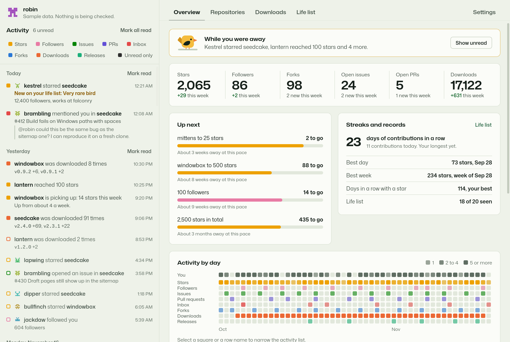
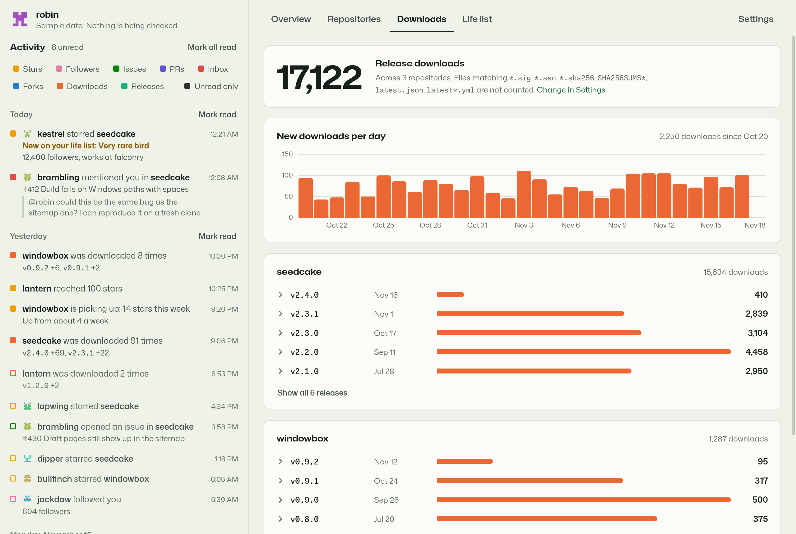
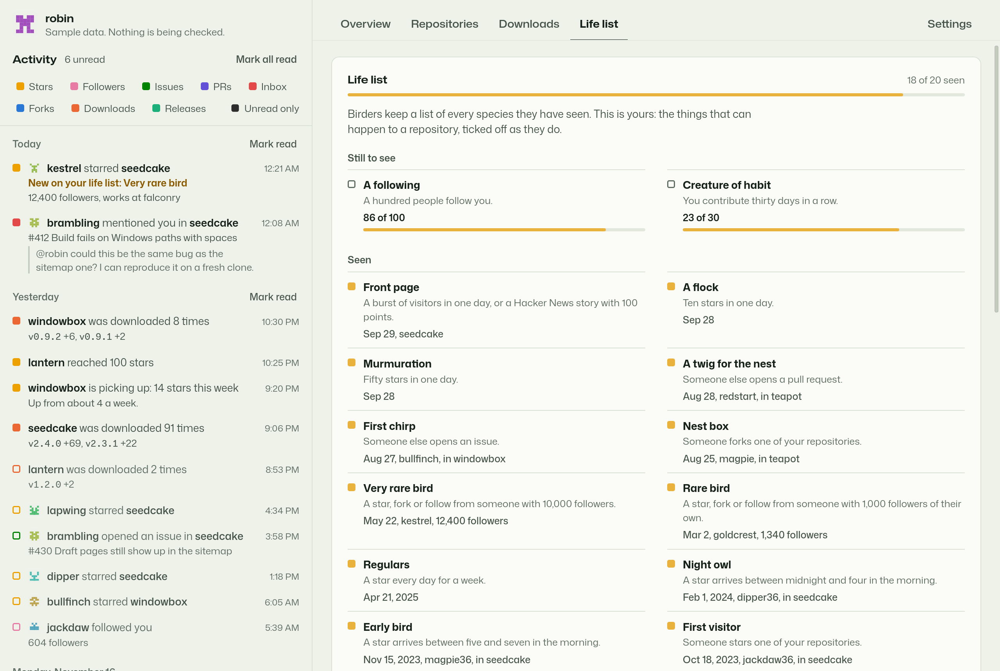
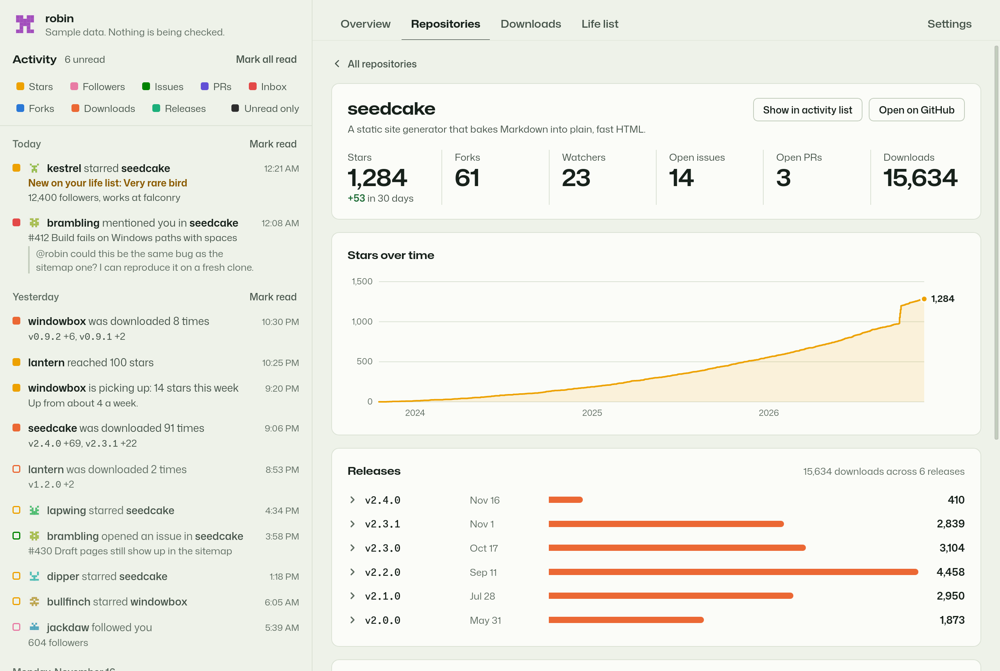

<p align="center">
  
</p>

<h1 align="center">Birdfeeder</h1>

<p align="center">
  A desktop app that tells you who has been visiting your GitHub repositories.<br>
  Put your code out, and watch who turns up.
</p>

<p align="center">
  <picture>
    <source media="(prefers-color-scheme: dark)" srcset="docs/screenshot-dark.png">
    
  </picture>
</p>

## Why

Somebody starring your project is one of the nicer things that happens on GitHub, and
GitHub never mentions it. Issues and mentions get an email. A star, a fork, a new follower,
or forty people downloading last night's release all happen in silence, and you find out
days later when a number looks different. Download counts are tucked inside each release,
and traffic figures are thrown away after two weeks.

Birdfeeder sits on your desktop and keeps an eye out. When something lands it tells you
what it was and who it came from, keeps a list you can scroll back through, and hangs on
to the history GitHub lets go of.

## What it does

**Notices the quiet things.** Stars, forks and followers arrive with a name and a face.
Lost stars and unfollows are written down too, without a notification, because nobody
needs that before coffee.

**Tells you who they are.** Anyone with a following of their own arrives with it: how many
people follow them, and where they work. Someone followed by a thousand people or more is a
rare bird, and gets called one.

**Shows what is nearly yours.** *Up next* lists the milestones you will reach soonest, how
far off each one is, and roughly when you will get there at the pace of the last month. One
star to go is a good reason to keep an eye on things.

**Counts your downloads.** Every release and every file in it, with a tally of what was
fetched each day. Signature files, checksums and updater manifests are left out by default,
since machines fetch those and they flatter the total. The list of what to leave out is
yours to edit.

<p align="center">
  <picture>
    <source media="(prefers-color-scheme: dark)" srcset="docs/downloads-dark.png">
    
  </picture>
</p>

**Keeps a life list.** Birders keep a list of every species they have seen. Yours has
twenty entries, from the first fork to fifty stars in a day, ticked off as they happen.
The open ones show how close you are.

<p align="center">
  <picture>
    <source media="(prefers-color-scheme: dark)" srcset="docs/life-list-dark.png">
    
  </picture>
</p>

**Remembers your best days.** Your best day and best week for stars, how many days running
someone has starred something, and your own contribution streak, with a small celebration
when it reaches a round number.

**Reads your inbox.** Mentions, replies, review requests and security alerts from any
repository appear in the same list as everything else, with the comment that set them
off. A new issue on your own repository shows up once, not twice.

**Shows a season at a glance.** The overview has a row for each kind of visitor and a
square for each day, like a contribution graph turned to face the other way. Your own
contributions run along the top, so you can see what you put out and who came for it.
Click a square and the list beside it narrows to that day.

**Keeps the traffic GitHub forgets.** Views and clones are read every few hours and kept
for good, so six months from now you can still find the week a link reached the front
page. A sudden crowd gets its own notification, along with where it came from, and so does
a repository whose stars run well ahead of its usual week.

<p align="center">
  <picture>
    <source media="(prefers-color-scheme: dark)" srcset="docs/repository-dark.png">
    
  </picture>
</p>

**Catches you up.** Come back to the window after a while and the first thing you read is
what happened while you were away, in one sentence. Milestones, records and new entries on
the life list get a moment of their own, with the bird and a scatter of seed.

**Draws your star history.** For each repository and for the whole account, back to the
first star rather than the day you installed the app.

**Marks the milestones.** The first star, the hundredth, the ten-thousandth download.

**Watches Hacker News, if you ask.** Off by default. Switch it on and Birdfeeder finds
stories that link to your repositories, follows their score, and tells you when one passes
a hundred points. It is the only time the app talks to anything other than GitHub, and all
it sends is your username.

**Knows when to be quiet.** The first check records recent history without a single
notification, and so does anything older that turns up afterwards, such as a repository
you start including. After that you only hear about what is new. Your own activity never
notifies, and neither do issues, pull requests or releases opened by bots. Each kind of
notification has its own switch.

**Keeps watching.** Close the window and Birdfeeder carries on in the background. Its tray
icon turns gold when something is waiting. It can start when you log in, and it checks as
often as every minute or as rarely as once a day.

**Only reads.** Birdfeeder cannot star, comment, close or mark anything as read. What it
learns stays in a SQLite file on your computer. There is no server, no account to create
and no telemetry.

## Try it without an account

```sh
birdfeeder --demo
```

This opens the app on sample data and never contacts GitHub. Every visitor in the sample
is a bird, which seemed only fair.

## Install

Grab the package for your system from the [Releases](../../releases) page.

```sh
# Fedora, RHEL, openSUSE
sudo dnf install ./Birdfeeder-*.x86_64.rpm

# Debian, Ubuntu, Mint
sudo apt install ./Birdfeeder_*_amd64.deb

# Anything else
chmod +x Birdfeeder_*.AppImage && ./Birdfeeder_*.AppImage
```

Birdfeeder is built and tested on Linux. It is a Tauri app, so Windows and macOS builds
should work, but nobody has tried them yet.

On GNOME the tray icon needs the
[AppIndicator extension](https://extensions.gnome.org/extension/615/appindicator-support/).
Without it everything else still works: Ctrl+Q quits, and opening Birdfeeder again brings
the window back.

## Signing in

If you use the [GitHub CLI](https://cli.github.com) and have run `gh auth login`, there is
nothing to do. Birdfeeder borrows that login.

Otherwise paste a personal access token in Settings. A classic token with the `repo` scope
covers private repositories, traffic and the inbox. GitHub does not let fine-grained tokens
read notifications, so use a classic one if you want the inbox. A pasted token is kept in
your system keyring, not in a file.

Birdfeeder watches one account. If the login changes to a different one, it stops and asks
before clearing what it has collected, so two accounts never end up mixed together.

## Using it

The list on the left is everything that has happened, newest first. A filled square means
you have not seen it yet. Click a row to open it on GitHub and mark it read, or clear a
whole day with the button beside its date.

The chips above the list filter by kind. The grid on the overview filters by kind and day.
A repository's page has a button that narrows the list to that repository. The life list
has its own tab, along with the best-followed people who have come by.

Ctrl+R checks now. Ctrl+1 to Ctrl+5 switch tabs. Esc clears the filters. Ctrl+Q quits.

Settings holds the rest: how often to check, whether to include forks, archived
repositories and organisation repositories, which events notify, and which release files
to leave out of the download count.

## Under the hood

A Rust core does the watching and a Svelte 5 interface runs in a
[Tauri](https://tauri.app) window, so the app uses your system's web view rather than
shipping a browser. The Linux package is about 7 MB.

Each check lists your repositories in one request and compares the counts with what it
saw last time. Only repositories that changed are read in detail. On a small account a
check where nothing happened costs five requests against GitHub's allowance of five
thousand an hour, and one more for every ten repositories that publish releases. Traffic
costs three requests per repository and is read at most every three hours, and a visitor's
profile is read once, the first time they turn up.

Everything GitHub returns goes through one module with no network code in it, which turns
it into events. Its rules are tested against an in-memory database: what counts as new,
what stays quiet, when a star was lost, when a busy day is worth mentioning.

Your data lives in `~/.local/share/io.github.gingerbreadfork.birdfeeder/birdfeeder.db`.

## Not planned

- **Writing to GitHub.** No replying, starring or marking as read. A tool that only reads
  can be trusted with a token.
- **More than one account at a time.**
- **A hosted version.** It runs on your computer and talks to GitHub directly.
- **Reminders to keep a streak going.** The streak is there to enjoy, not to nag.

## Building from source

You need Rust, Node 24, pnpm and
[Tauri's system packages](https://tauri.app/start/prerequisites/).

```sh
pnpm install
pnpm tauri dev              # run it
pnpm tauri dev -- -- --demo # run it on sample data
pnpm tauri build            # build packages into src-tauri/target/release/bundle
```

Checks:

```sh
pnpm check                           # Svelte and TypeScript
cd src-tauri
cargo test                           # the event rules, against an in-memory database
cargo test -- --ignored live_sync    # one real check, using the GitHub CLI's login
```

The interface is in `src/`. In `src-tauri/src/`, `github.rs` talks to the API, `sync.rs`
decides what to fetch, `apply.rs` turns what came back into events, and `watch.rs` runs the
background loop and the notifications.

## License

MIT. See [LICENSE](LICENSE).
